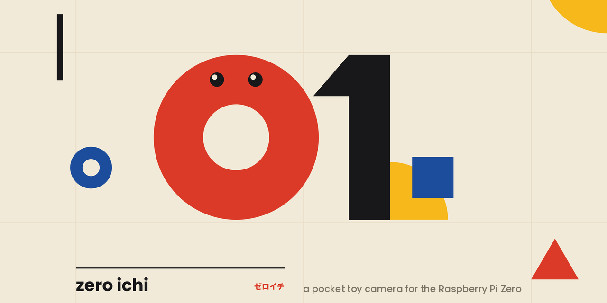
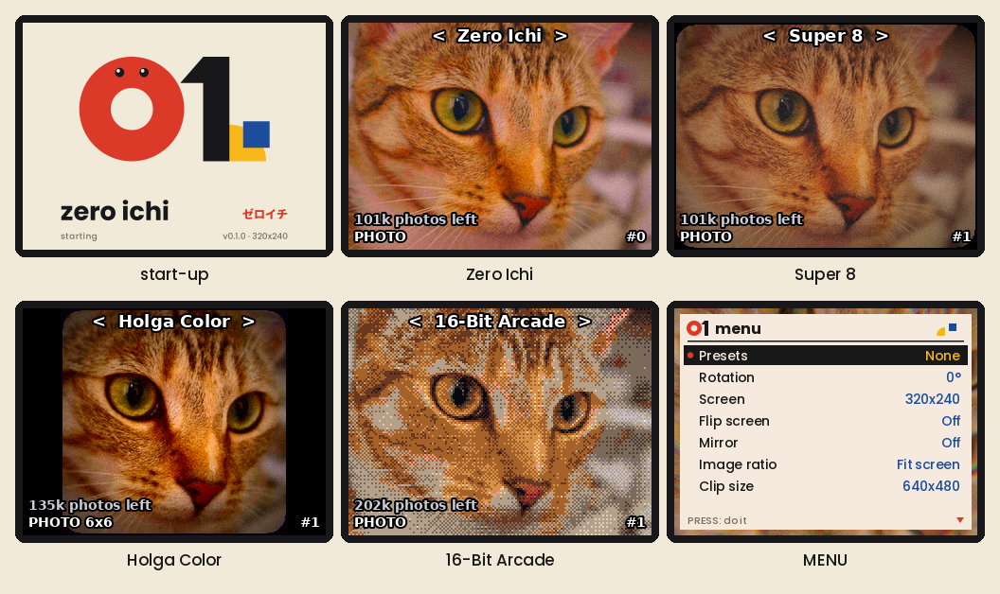
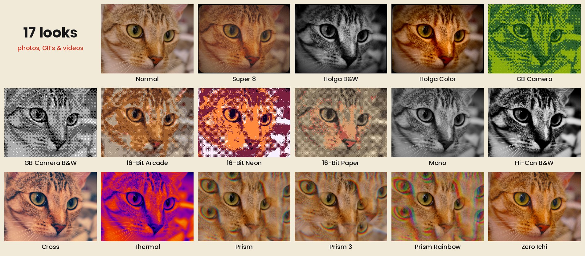

# Zero Ichi ゼロイチ



**A pocket toy camera for the Raspberry Pi Zero** — by thegilai

Zero Ichi ("zero one") turns a Raspberry Pi Zero, a small camera module and a
tiny LCD hat with a joystick into a toy camera:

- **17 looks**, each shown live on the screen:
  - Super 8 film
  - Holga (B&W and colour)
  - Game Boy Camera style
  - 16-bit pixel art
  - Hi-Con B&W, Mono, Cross, Thermal
  - three kaleidoscope prisms
  - Zero Ichi's own colour film
- **Photos, animated GIFs and videos.** Videos are saved the moment you stop,
  with any look. Each file records the look it was made with (e.g. "Look:
  Super 8") - and no date or location.
- **Offline by design:** no Wi-Fi, no Bluetooth, no apps. Your pictures leave
  the camera only on its SD card. On a Zero W or Zero 2 W the radios are
  switched off in the firmware.
- **Ready in about 5 seconds** from power-on.
- **Safe to unplug** whenever the red dot isn't showing. The SD card is
  read-only between saves.
- **The whole SD card for photos**, presets, a gallery, a screen saver,
  Standby and Erase all.

Version **0.1.0** — see [CHANGELOG.md](CHANGELOG.md).





*Screens from Zero Ichi's own program on the 2.8inch screen; the looks as Zero
Ichi saves them in a photo. Sample photo: "Chelsea" from scikit-image (CC0).*

## Project summary

Zero Ichi is a small, offline toy camera you build yourself. It started from
the [SeedSigner](https://seedsigner.com) project: the same hardware (a
Raspberry Pi Zero, a camera module and a 1.3inch LCD hat with a joystick and
three keys) and the same idea of a simple, single-purpose device with no
network. SeedSigner uses that hardware for Bitcoin signing; Zero Ichi turns
it into a camera.

The goal is a camera that feels like a toy film camera:

- you choose a look and see it live;
- you press the button and the picture is there;
- there's nothing to connect, update online or sign in to.

Everything stays on the SD card. The camera is quick to start, safe to unplug,
and runs without Wi-Fi or Bluetooth.

Zero Ichi is designed by thegilai. The code was written with the help of
Claude, Anthropic's AI assistant.

## What you need

| Part | Notes |
|---|---|
| Raspberry Pi Zero | Made and tested on a Pi Zero v1.3. Zero W / Zero 2 W should work too. |
| OV5647 camera module | Raspberry Pi Camera v1.3 or a compatible 5 MP OV5647 module, plus a Pi Zero camera cable. |
| Screen with joystick + 3 keys | Waveshare 1.3inch LCD HAT (240×240), or a 2.8inch 320×240 display hat with the same pins and buttons. Other 320×240 ST7789 / ILI9341 SPI screens can be set in `settings.txt`. |
| microSD card | 8 GB or more (16–32 GB recommended). |
| Power | 5 V 2.5 A supply or a battery pack. |

## Install

**Ready-made card image** (if one is attached to the release): flash
`zeroichi-card.img.xz` onto a microSD card with
[balenaEtcher](https://etcher.balena.io/) or Raspberry Pi Imager, put it in
the Pi and switch on.

**From the SD card kit** (`zeroichi-sdcard.zip`):

1. Flash **Raspberry Pi OS Lite (32-bit)** with balenaEtcher. With Raspberry Pi
   Imager, don't use its OS customisation settings.
2. Copy everything from the kit onto the card's `bootfs` drive, and choose
   *Replace* when asked.
3. Run `GET-PACKAGES.bat` (Windows) or `GET-PACKAGES-MAC.command` (Mac/Linux)
   from the card. Then put the card in the Pi and follow the screen. The Pi
   Zero has no internet, so your computer downloads the 3 packages it needs.

### Verify your download (SHA-256)

Each release lists a SHA-256 checksum for every file in `SHA256SUMS.txt`.
Checking it confirms your download is complete and is exactly the file that
was published. Run this in the folder with the download, then compare the
long code it prints with the one in `SHA256SUMS.txt`. They must match
exactly.

| System | Command |
|---|---|
| Windows (PowerShell) | `Get-FileHash zeroichi-sdcard.zip -Algorithm SHA256` |
| Windows (Command Prompt) | `certutil -hashfile zeroichi-sdcard.zip SHA256` |
| Mac | `shasum -a 256 zeroichi-sdcard.zip` |
| Linux | `sha256sum zeroichi-sdcard.zip` |

On Mac and Linux, you can also put `SHA256SUMS.txt` in the same folder and
check everything at once: `shasum -a 256 -c SHA256SUMS.txt` (Mac) or
`sha256sum -c SHA256SUMS.txt` (Linux). Each file should say **OK**.
If the codes don't match, don't use the file: download it again.

The full guide is in [README-FIRST.txt](README-FIRST.txt). It covers the
buttons, the menu, every look, presets, screens, updating, making card images
and troubleshooting.

## Controls

| Button | In the camera |
|---|---|
| KEY1 | Photo / start + stop recording |
| KEY3 | Mode: PHOTO → GIF → VIDEO (hold 3 s: power off) |
| Joystick ←/→ | Change look |
| Joystick ↑/↓ | Brightness |
| Joystick press | Menu |
| KEY2 | Gallery |

## How it works

- A small **C program** (`zeroichi/src/zeroichi-c`) runs the camera, the looks,
  the screen and the encoders. A tiny **Python camera helper** (`camd.py`)
  drives libcamera and hands over its frame buffers without copying them.
- A custom **fast start** (`fast-start.sh`) runs as the first process. It
  skips the normal Linux start-up, so the camera is ready in about 5 seconds.
- The original **Python Zero Ichi** (`app.py`, `filters.py`, …) stays on the
  card as a backup. It makes pixel-for-pixel the same pictures.

### Building

`zeroichi-c` and `zeroichi-lcd` are built for the Pi Zero (ARMv6, static) with
[zig](https://ziglang.org) as the cross compiler and
[libjpeg-turbo](https://libjpeg-turbo.org). See
`zeroichi/src/zeroichi-c/build.sh`:

```sh
sh zeroichi/src/zeroichi-c/build.sh <libjpeg-turbo source> <its ARM build dir>
```

## Say hello and help out

- **Questions, ideas or photos you took?** Join the [Discussions](../../discussions).
- **Something not working?** Open an [issue](../../issues/new/choose).
- **Want to help more?** See [CONTRIBUTING.md](CONTRIBUTING.md).

## Credits

- Designed by **thegilai**. The code was written with the help of **Claude**
  (Anthropic's AI assistant).
- Based on the [SeedSigner](https://github.com/SeedSigner) project's hardware and
  idea. Thanks to the SeedSigner team. Zero Ichi is a separate project, not
  made by or affiliated with SeedSigner.

## Licence

MIT — see [LICENSE](LICENSE). Zero Ichi includes work by others:
libjpeg-turbo, musl, Pillow's image operations, and the Poppins and DejaVu
fonts. Their notices are in [THIRD-PARTY-NOTICES.txt](THIRD-PARTY-NOTICES.txt).
This software is based in part on the work of the Independent JPEG Group.

Holga, Game Boy and Kodachrome are trademarks of their owners. The looks are
inspired by them, and Zero Ichi is not affiliated with them.
